  
  
   
  
  
  
    
  
  
  

  
  
   
  
    

  
  
   
   
  
  
   
  
    

  
  
  
   
  
  <picture>
    <source media="(prefers-color-scheme: dark)" srcset="https://raw.githubusercontent.com/vishruth1729/vishruth1729/output/github-snake-dark.svg" />
    <source media="(prefers-color-scheme: light)" srcset="https://raw.githubusercontent.com/vishruth1729/vishruth1729/output/github-snake.svg" />
    
  </picture>
    

  

    
<b>🕹️ PRESS START</b>

     
    Are you GitHub? Because I want to commit to you.
  

  

  <i>⭐️ From <a href="https://github.com/vishruth1729">vishruth1729</a></i>

